# AI Pulse

A daily AI news dashboard you can scan in five minutes. AI Pulse pulls AI/ML news from about 35 public feeds and APIs: lab blogs, arXiv, tech press, Hacker News, Reddit and newsletters. It then:
- removes duplicates and groups coverage of the same event into one **story**;
- has an LLM write a short paraphrased summary for each story, with a category, a 1–5 importance score and a "why it matters for an applied AI engineer" line;
- writes a top-10 daily briefing plus 3 article ideas;
- tracks which companies, models and topics are rising.

**Fresh news when you open it:** the first visit each day (in `APP_TIMEZONE`) fetches and processes that day's news in the background. A banner shows progress and the page updates when it finishes. Later visits that day load instantly from the database. **Refresh** forces a new run at any time.

## Quick start

### Docker (one command)

```bash
cp .env.example .env          # add OPENAI_API_KEY (or set LLM_PROVIDER=none)
docker compose up --build     # http://localhost:8000
```

Data lives in `./data/ai_pulse.db`. If Docker Hub rate-limits you (HTTP 429), pull the same official images from Google's mirror first: `docker pull mirror.gcr.io/library/python:3.12-slim && docker tag mirror.gcr.io/library/python:3.12-slim python:3.12-slim`, and the same for `node:22-alpine`. `sources.yaml` is mounted into the container, so you can edit sources without rebuilding. To build a smaller image without PyTorch, set the build arg `WITH_ML: "0"`; it then uses the built-in hashing embedder.

### Local

Requires Python 3.11+ and Node 20+.

```bash
make demo    # venv + npm install, build UI, run the pipeline once on real feeds, serve on :8000
```

Other targets:

| target | what it does |
|---|---|
| `make setup` | create `.venv`, install backend + frontend deps, create `.env` |
| `make setup-ml` | also install `sentence-transformers` (CPU torch) for better dedupe/clustering |
| `make test` | backend unit tests |
| `make run` | one pipeline run from the command line (logs per-source results and token usage) |
| `make serve` | start the app |
| `make dev` | API with reload on :8000 + Vite dev server on :5173 |

## Configuration (`.env`)

| variable | default | notes |
|---|---|---|
| `LLM_PROVIDER` | `openai` | `openai`, `anthropic` or `none` (heuristic categories, no summaries) |
| `LLM_MODEL` | `gpt-6-luna` | model for enrichment; `LLM_DIGEST_MODEL` / `LLM_CHAT_MODEL` override the digest and chat |
| `OPENAI_API_KEY` / `ANTHROPIC_API_KEY` | | never commit these; `.env` is git-ignored |
| `LLM_MAX_CALLS_PER_RUN` | `40` | **cost guard**: hard cap on LLM calls per run |
| `LLM_MAX_TOKENS_PER_RUN` | `400000` | **cost guard**: stop calling once this many tokens were used |
| `ENRICH_BATCH_SIZE` | `8` | stories summarized per call (fewer calls, cheaper) |
| `ENRICH_WINDOW_DAYS` | `7` | summarize stories from the last N days, highest-ranked first; one call is always kept for the digest |
| `APP_TIMEZONE` | `UTC` | defines "today" for the once-per-day run |
| `AUTO_RUN_ON_OPEN` | `true` | first visit of the day triggers the run |
| `SCHEDULE_CRON` | | optional, e.g. `0 6 * * *`, to also run on a schedule (useful with email) |
| `EMBEDDING_BACKEND` | `auto` | `sentence-transformers` (all-MiniLM-L6-v2, local) with a hashing fallback |
| `DEDUPE_THRESHOLD` / `CLUSTER_THRESHOLD` | per backend | cosine similarity; MiniLM defaults 0.90 / 0.70 |
| `APP_PASSWORD` | | set it before exposing the app publicly (HTTP Basic auth, any username) |
| `SMTP_*` | | optional: email the daily digest after each run |
| `DATABASE_URL` | SQLite in `./data` | any SQLAlchemy URL, e.g. `postgresql+psycopg://…` (install the driver) |

Every LLM call is logged (purpose, model, input/output tokens) to the `llm_usage` table and the server log. Totals per run are in `runs.stats` and at `/api/usage`.

## Architecture

```mermaid
flowchart LR
    subgraph Sources["sources.yaml (≈35 feeds)"]
        A[Lab blogs RSS]
        B[arXiv RSS / HF Daily Papers API]
        C[Tech news RSS]
        D[Hacker News Algolia API<br/>Reddit JSON]
        E[Newsletters RSS]
    end
    Sources -->|async httpx, retries,<br/>timeouts, per-source health| F[Fetch + parse]
    F -->|normalized URL = exact dedupe| G[(SQLite / Postgres<br/>items)]
    G --> H[Embed title+snippet<br/>sentence-transformers]
    H --> I[Near-duplicate merge<br/>cosine ≥ dedupe threshold]
    I --> J[Cluster into stories<br/>online centroid, 3-day window]
    J --> K[LLM enrichment<br/>summary · category · importance<br/>why it matters · entities]
    K -->|copy guard + cost guard| L[(stories, entities)]
    L --> M[Daily digest<br/>top 10 + 3 article ideas]
    L --> N[Trends<br/>this week vs last week]
    M --> O[FastAPI /api]
    N --> O
    L --> O
    O --> P[React + Vite + Tailwind UI]
    O --> Q[Ask the news<br/>retrieval + cited answer]
    M -.optional.-> R[SMTP email]
    P -->|first visit of the day| S{{run today?}}
    S -->|no| F
```



**Pipeline stages** (`backend/app/runner.py`):

1. **Fetch** (`fetcher.py`, `parsers.py`): all sources are fetched concurrently with retries and exponential backoff (honoring `Retry-After`). A broken or timed-out feed never fails the run; its error appears on the Sources page. Items older than `max_age_days` are dropped, and general-tech feeds can be limited to AI keywords (`ai_filter`).
2. **Dedupe** (`urlnorm.py`, `dedupe.py`): URLs are normalized (tracking params stripped, `www.`/`m.` removed, arXiv `pdf`/`abs`/`vN` unified), so the same article is stored once. Items with near-identical embeddings or matching titles become *duplicates* of a canonical item but stay as extra source links.
3. **Cluster** (`cluster.py`): canonical items join the most similar story centroid within a 3-day window if similarity passes the threshold; otherwise they start a new story. arXiv papers only merge with near-identical papers, so different papers on one topic stay separate.
4. **Enrich** (`enrich.py`): unenriched stories, highest-ranked first, are sent to the LLM in batches. The output is validated: category from a fixed list, importance clamped to 1–5. A **copy guard** rejects any summary that shares 15+ consecutive words with a source or quotes more than 15 words. Without an LLM, stories still get heuristic categories and entities.
5. **Digest** (`digest.py`): an LLM writes the top-10 briefing and 3 article ideas from the day's stories and rising trends. There is a heuristic fallback.
6. **Trends** (`trends.py`): entity and topic mention counts for the last 7 days vs the previous 7, plus a 14-day daily series for the charts.

**Ranking** blends LLM importance, number of distinct outlets, source weight (labs count more), HN/Reddit/HF points and recency.

## Adding or removing sources

Edit `backend/sources.yaml`:

```yaml
  - id: my-blog                 # unique, stable id
    name: My Favorite Blog
    type: rss                   # rss | hn | reddit | hf_papers
    url: https://example.com/feed.xml
    group: newsletter           # lab | research | news | community | newsletter
    ai_filter: true             # optional: keep only AI-related posts
    max_items: 20               # optional
    weight: 1.2                 # optional ranking boost
```

Set `enabled: false` to pause a source without deleting it. Changes apply on the next run; click **Refresh** to run now. The **Sources** page shows each feed's last fetch, item count and last error.

Notes on the default list:
- Anthropic, Mistral, Cohere and xAI don't publish official RSS feeds. AI Pulse uses the community-maintained mirrors at [Olshansk/rss-feeds](https://github.com/Olshansk/rss-feeds), which link to the original articles. The same mirrors add OpenAI Research, Anthropic Research, Google's developer AI blog, Cursor and Ollama. Meta AI uses a Google News site search because its mirror is stale. Swap in official feeds if they appear.
- Papers with Code was shut down in 2025 and now redirects to Hugging Face, so that entry is disabled. Hugging Face Daily Papers covers trending papers.
- Reddit sometimes rate-limits or blocks anonymous JSON requests from cloud IPs. Those sources then show an error and the run continues.

## Web UI

- **Today:** the daily briefing, then story cards grouped by category. Sort by top, importance or newest. Filter by category, source, date range, minimum importance and unread, or use full-text search over titles, summaries, snippets and entities.
- **Story:** summary, why it matters, every source link with its discussion thread, mentioned entities, and related stories.
- **Saved:** bookmarked stories. Opening a story marks it read.
- **Trends:** rising entities, 14-day mention charts, most-mentioned companies, models and topics, and categories this week vs last week.
- **Ask:** questions answered only from stored stories, with numbered citations linking to the originals.
- **Sources:** per-feed health.

The UI is mobile-friendly, with light and dark mode (follows the system setting, with a toggle).

## Running it on a server

The same `docker compose up -d --build` works on any small VPS (1 vCPU / 2 GB RAM is enough; use `WITH_ML=0` on 1 GB).
1. Set `APP_PASSWORD` in `.env` before exposing it.
2. Put it behind a reverse proxy with TLS, such as Caddy: `ai.example.com { reverse_proxy localhost:8000 }`.
3. Set `PUBLIC_BASE_URL` so links in the email digest point to the server.
4. Optionally set `SCHEDULE_CRON` and `SMTP_*` to get the digest by email each morning without opening the site.

## Tests

```bash
make test
```

The tests cover:
- feed parsing: RSS, Atom, HN, Reddit, HF papers, dates and time zones, HTML cleanup, AI keyword filter;
- URL normalization;
- near-duplicate detection and clustering: time window, research-paper rule, title preference;
- the copy guard, LLM JSON parsing and the cost guard with token logging;
- a full pipeline run against a mocked HTTP layer, including failing and garbage feeds, a fake LLM, and every API endpoint;
- password protection.

## Project layout

```
backend/
  app/            fetcher, parsers, urlnorm, embeddings, dedupe, cluster, llm, enrich,
                  digest, trends, ask, emailer, runner, api, main, cli
  sources.yaml    the source list
  tests/          pytest suite + fixtures
frontend/         React + Vite + Tailwind single-page app (served by FastAPI in production)
Dockerfile, docker-compose.yml, Makefile, .env.example
```
